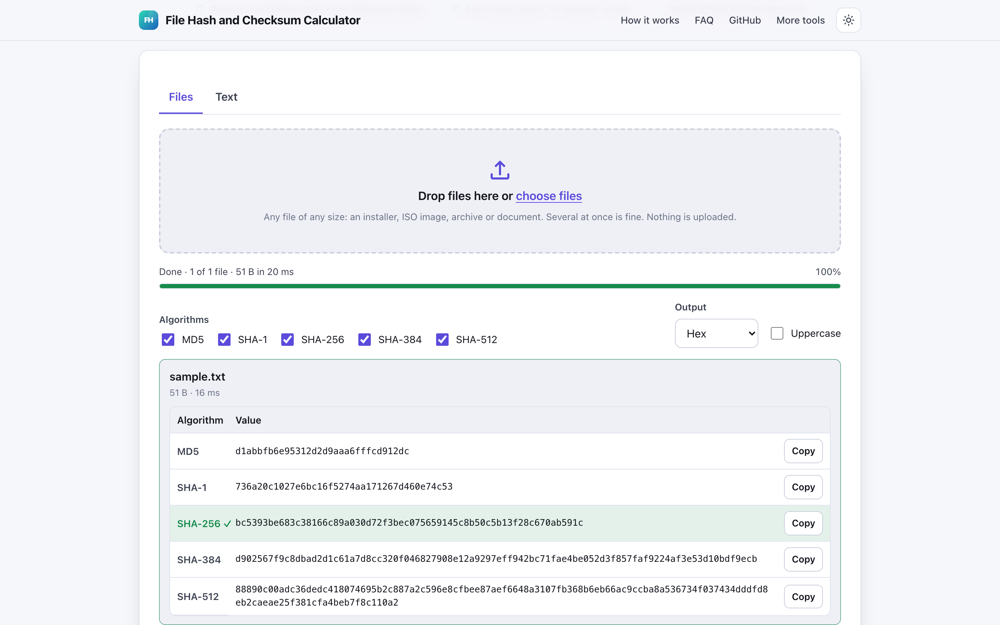
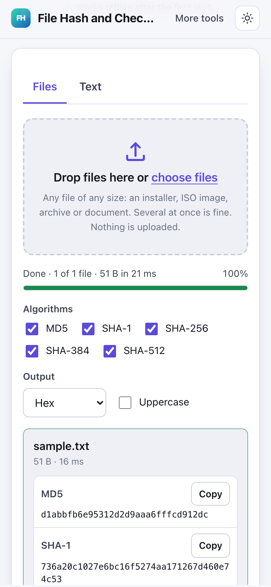

# File Hash and Checksum Calculator

> Compute MD5, SHA-1, SHA-256 and SHA-512 for text or files in your browser and compare with a known hash.

**🌐 Use it now: [turhe123.github.io/file-hash-checker](https://turhe123.github.io/file-hash-checker/)** · free · open source · runs in your browser · works offline


## Why

This is a free, open-source alternative to Online MD5 and SHA hash generators and file checksum sites. Many of those upload your file to compute the hash, which defeats the point when you are verifying something you may not trust yet. Others add ads, cap the file size or offer MD5 only. Here your files never leave the device, there is no account, no ads and no size limit, it works offline, and it can be installed as an app.

## Screenshots

<p align="center"></p>

<p align="center"><em>File Hash and Checksum Calculator in the browser, light theme</em></p>

<p align="center"></p>

<p align="center"><em>File Hash and Checksum Calculator on a phone</em></p>

## Features

- Files tab: drop or choose one or many files of any size. Files are read in slices (4 MB on computers, 1 MB on phones) by a Web Worker, so the page stays responsive and multi-gigabyte files are fine on a computer.
- Text tab: hashes the UTF-8 bytes of what you type, live, with an option to include a trailing newline (the usual cause of mismatches against `echo ... | sha256sum`).
- Five algorithms shown together, each with a copy button: MD5, SHA-1, SHA-256, SHA-384 and SHA-512. Any of them can be switched off (at least one stays on).
- Output as hex (with an uppercase toggle) or Base64.
- Progress bar with byte counts, throughput and a Cancel button while hashing.
- Expected hash box that compares automatically against every result and says which algorithm matched, with a Match / No match / Waiting chip. It accepts a bare hash, a `hash  filename` line, a BSD `SHA256 (file) = hash` line, `SHA-256: hash`, hex with colons, dashes or spaces, and Base64. Case is ignored. Mismatch messages hint at the likely algorithm from the hash length.
- Pasting with Ctrl/Cmd+V into the compare field, or anywhere on the page outside a text box, fills the field and compares immediately.
- Multiple files at once, with per-file errors shown in a visible alert (unreadable files, dropped folders, out-of-memory).
- Downloads: `checksums.txt` in the standard two-column format (`<hex>  <file name>`, readable by `sha256sum -c` and similar) for the algorithm you choose, and `hashes.csv` with every selected algorithm.
- Startup self-test of the hand-written hash code against known vectors; a warning is shown if it fails.
- Light and dark themes, keyboard-usable tabs and controls, layout that works at 390 px wide.
- Installable and offline-ready through a service worker.

**Input:** any file (read through the browser File API) or typed/pasted text.
**Output:** hex or Base64 digests on screen; `checksums.txt` (hex) and `hashes.csv` downloads.
**Limits:** no size limit is imposed by the page. Very large files on phones (over 1 GB) can exhaust memory in mobile browsers and a warning is shown. Folders cannot be hashed; drop the files inside instead. MD5 and SHA-1 are broken for security and are suitable only for detecting accidental corruption.

## How to use

1. Open the Files tab and drop one or more files, or open the Text tab and type or paste text.
2. Read the MD5, SHA-1, SHA-256, SHA-384 and SHA-512 results. Choose hex or Base64, uppercase, and which algorithms to show.
3. Paste the hash published by the file's author into the Expected hash field. The chip turns to Match or No match and the matching row is highlighted.
4. Optionally download `checksums.txt` or `hashes.csv`, or copy a single value with its Copy button.

## Privacy

- Nothing is uploaded. Files and text are hashed on your device and never sent to a server.
- No cookies.
- Page views are counted anonymously with [GoatCounter](https://www.goatcounter.com/) (cookieless, open source). That is the only network request the page makes besides loading its own files.
- After the first visit a service worker caches the page so it works offline.

## Run it locally

```sh
git clone https://github.com/turhe123/file-hash-checker
cd file-hash-checker
python3 -m http.server 4173
```

Then open http://127.0.0.1:4173/. There is no build step.

## Tests

```sh
npm i -D @playwright/test && npx playwright install chromium
npx playwright test
```

## Third-party code

None: browser APIs only.

## Built with AI

File Hash and Checksum Calculator was written by [Claude Code](https://claude.com/claude-code) inside an automated pipeline, from a plain-English spec. No code or assets from any commercial product were used; it is a clean-room implementation of a feature set, not a copy.

What that means in practice:

- The full source is in this repo under the MIT license. Read it before you trust it with your files.
- Everything runs in your browser. It makes no network requests except an anonymous, cookieless page-view count (GoatCounter); your files never leave the device.
- The page is tested headless in Chromium (Playwright) before every release, but it has had less human review than hand-written software. Bug reports and pull requests are welcome.

## Support ❤️

If this tool saved you time, you can support its upkeep on [Ko-fi](https://ko-fi.com/leodavidai).

## More free web tools

Find more at [turhe123.github.io/web-tools](https://turhe123.github.io/web-tools/).

## License

MIT © Or Davidai Bachar
